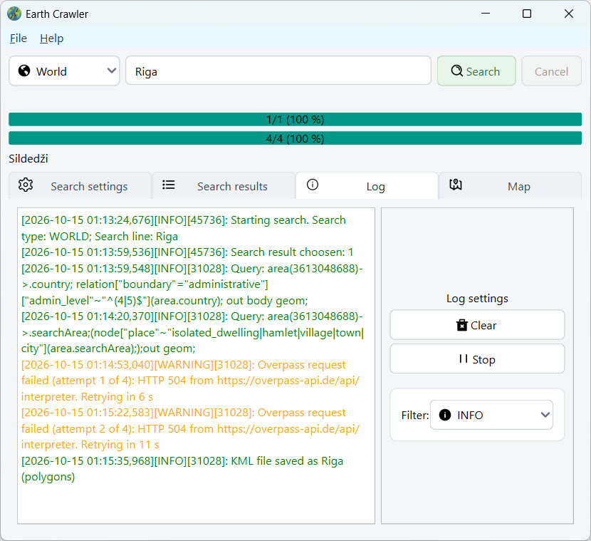
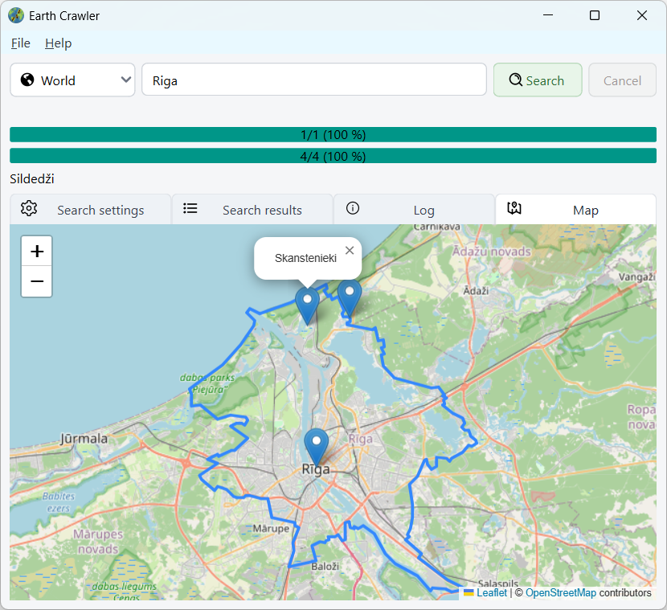

<div align="center">
    
    <h1>Earth Crawler</h1>
</div>

  

Earth Crawler is a desktop application for extracting geographic data from OpenStreetMap (OSM), including administrative boundaries, settlements, and related location metadata.

It supports searching by region, optionally narrowing results by administrative level, exporting the results to KML or Excel, and visualizing search results on an embedded map.

>[!NOTE]
>The application was designed for a specific use case to simplify user experience of retrieving administrative boundaries from OSM maps. It fully depends on OSM data and its structure, which may change over time. The application is not intended for general-purpose OSM data extraction or analysis.

## Features

- Search OSM data for regions and settlements
- Filter by administrative level using `region_name=admin_level`
- Query multiple objects at once: `object1=admin_level1; object2=admin_level2; ...`
- Search scope modes:
  - World
  - Country
  - State
- Search for:
  - borders
  - locations
  - supported place types: locality, isolated dwelling, hamlet, village, town and city
- Export data to KML (borders and locations) and Excel (locations)
- Open search results on a map
- Choose the display language of object names
- Cancel a running search at any time
- Automatic retries when the server is overloaded or temporarily unavailable
- Configurable application settings and export directory

## Installation

### Binaries

Download the latest version from the [Releases](https://github.com/ikomash/earth-crawler/releases) page and run `earth_crawler.exe` (Windows) or `earth_crawler` (Linux).

### Local setup

Python 3.9 or newer is required.

```bash
git clone https://github.com/ikomash/earth-crawler.git
cd earth-crawler
python -m pip install -r requirements.txt
python src/earth_crawler.py
```

### Docker

```bash
docker compose up --build
```

The Docker setup starts the application with the required GUI and display configuration for Linux/WSL environments.

### Building a binary

```bash
python scripts/build_with_pyinstaller.py                    # Windows
python scripts/build_with_pyinstaller.py --platform linux   # Linux
```

The build dependencies are listed in `requirements-build.txt`. The application is placed in `builds/<version>/<platform>/earth_crawler`. The Windows build expects UPX in `scripts/upx/`; use `--no-upx` to build without it. `--console` builds a version with a console window that shows the errors of the program.

## Usage

1. Launch the app from the binary, `python src/earth_crawler.py` or via Docker.
2. Select the search mode: World, Country, or State (helps filtering results).
3. Enter the region name to search.
   - You can specify the administrative level in the format `region_name=admin_level`. If no level is specified, level 4 is used. The administrative level of the found object itself is always added to the requested ones, so its own border is included: `Russia=4` searches levels 2 and 4. Admin levels are defined by OSM and can be found [here](https://wiki.openstreetmap.org/wiki/Key:admin_level).
   - Levels can be given as:
     - a single value: `region_name=5`
     - a range, both ends included: `region_name=[3,5]` means 3, 4 and 5
     - an open range: `region_name=[3,]` means 3 up to 11, `region_name=[,6]` means 2 up to 6
     - a list: `region_name=(3,4,5)` means exactly 3, 4 and 5
   - Allowed values are typically between 2 and 10
   - To search multiple entries, separate them with `;`
4. Adjust search settings if needed, such as location type filters, border search, and export format.
5. Click Search or press Enter. Cancel stops the running search.
6. If `Choose from results` is enabled (default), go to the Search results tab, which lists the candidates OSM found for the name, select the desired entry, and click Process. Otherwise the first candidate is used automatically.
7. While the search runs, progress and messages are shown in the Log tab. When it finishes, the Map tab shows the results (if any were found) and the data is exported in the selected formats to the specified directory.

## Example queries

```text
France
Russia=4
london;paris;berlin
Riga=[3,5]
Riga=(3,4,5)
Berlin=(3,4)
Tallinn=[3,]
```

## Notes

- **KML** contains borders and locations in full detail. **Excel** contains locations only (columns: location, place, lon, lat).
- The **map** is for a quick look: outlines are simplified, at most 20 000 locations are shown, and many locations are grouped into clusters. Use the exported files for the complete data.
- The public OSM servers limit the load. Requests that fail because the server is overloaded are repeated automatically (4 attempts with growing pauses). A very large request, for example all settlements of a big country, can still be stopped by the server after about 3 minutes: split it into smaller regions or choose fewer place types.
- Messages and errors are shown in the Log tab and written to the log file (see the `logs` folder).

## Screenshots

### Settings tab


### Search results tab


### Log tab



### Map tab



## Data

Map data is © OpenStreetMap contributors and is available under the [Open Database License](https://www.openstreetmap.org/copyright). It is requested from the public OpenStreetMap services (Nominatim and Overpass API).

## License

This project is distributed under the MIT license. See [LICENSE](LICENSE) for details.